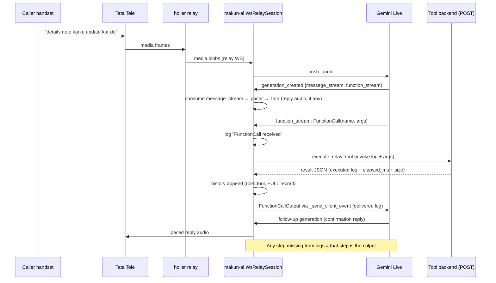

# PSTN SIP-Relay Architecture (Tata Tele)

> **Version:** 1.0 · **Last Updated:** 2026-10-07
> **Scope:** holler-service ↔ makun-ai direct SIP-trunk relay (Tata Tele carrier)

---

## 1. What this system is

Voice calls to/from the Indian PSTN network without a LiveKit room on the
media path. Tata Tele delivers caller audio over a Twilio-shaped WebSocket;
holler-service stays the carrier-facing endpoint and relays frames over a
second WebSocket to makun-ai, which drives a Gemini Live speech-to-speech
session and streams agent audio back. No SFU hop, no Opus transcoding — μ-law
end to end.

Out of scope: browser/WebRTC calls (LiveKit path, owned by makun-ai), the
voiceai/talko trunk (separate system, same design lineage).

## 2. System context

| Piece | Repo / service | Role |
|---|---|---|
| Carrier | Tata Tele SmartFlo | μ-law 8kHz, 20ms frames, Twilio-shaped WS events (`connected/start/media/mark/stop`) |
| Relay + API | holler-service | Carrier WS endpoint; DID resolve; outbound dial; frame pacing toward Tata |
| Agent engine | makun-ai (`voiceai-engine`) | `WsRelaySession`: STT/LLM/TTS orchestration, Gemini Live session, greeting |
| Config source | makun-ai Mongo (agents, numbers), holler Mongo (DIDs, CDRs) | Per-call lookup, never cached beyond documented TTLs |
| Auth between hops | HMAC stream token (`MAKUNAI_STREAM_SECRET`) or single-use ticket POST | Minted per call, 300s TTL |

## 3. Call flows

### 3.1 Outbound AI-bridge call (common case)

```mermaid
flowchart LR
    TATA[Tata Tele\nμ-law 8kHz, 20ms] <-->|wss static endpoint| H[Holler relay]
    subgraph H [holler-service]
      H0[session_id per attempt\n{to_number}_{hex}\n→ pending → relay start]
      H1[adaptive ingress jitter\nEMA 60/120 → 200/300ms]
      H2[ordered outbox\n20ms pace, sparse marks\nack-window backpressure]
    end
    H <-->|wss /ai/v1/voice/stream +\nHMAC ticket + session_id| M[makun-ai WsRelaySession]
    subgraph M [makun-ai: no LiveKit room]
      M1[setup: agent-load ∥ carrier-start]
      M2[greeting: committed file → memo →\noverlay → live TTS race]
      M3[Gemini Live via livekit-agents\n16kHz in / 24kHz out]
      M4[120ms pacer + turn-end flush\n+ playout gate + barge-in grace]
      M5[transcripts: input finals +\nreply text + greeting turn\n→ history under shared\nsession_id + vendor callSid]
    end
    M5 -.->|Mongo chat_transcripts| UI[Playground / calls dialog\nlooks up {phone}_{hex}]
    M -.->|WS-start: recipient set_call_id +\nCampaignCDR DIALING| CAMP[Campaign recipient]
```

1. UI/campaign → holler `POST /call`: CDR row + `pending_context` (incl. `cdr_id`
   and per-attempt `session_id`) stored in Redis; AI-bridge pre-warm fires.
2. Tata dials customer; on answer Tata opens WS `start` → holler resolves DID,
   attaches pending context, enriches start block (`session_id`, `cdr_id`,
   `caller_did`, …) and opens the makun-ai relay WS.
3. makun-ai loads agent config concurrently, builds the Gemini session
   (instructions + tools pre-connect), speaks the greeting deterministically
   (~0.3–2s, never via model proactivity).
4. Media loop both ways; turns persist to history under the shared session id.
5. `stop` → forward → cleanup both legs; Tata CDR webhook enriches by call id.

### 3.2 Inbound call

Same minus dial steps: DID from Tata `start.to`, no pending context (falls
back to carrier callSid as session id).

## 4. Component deep dive

### 4.1 Holler relay (`src/components/pstn/makunai_relay.py`)

- **Ingress (Tata → engine): adaptive jitter buffer.** Frames should arrive
  every 20ms but bunch up (measured 350–540ms bursts, `missing_frames=0` =
  bunched not lost). Hold target follows an EMA of inter-arrival gaps
  (60/120ms base → 200/300ms caps); control frames (stop/mark) bypass.
  Cost lands only on the agent's listen path, never the caller's ear.
- **Egress (engine → Tata): paced sender.** Engine blobs split to exactly
  160B (`_split_frames`, short tail padded with μ-law `0xFF` silence), sent
  at most 1 frame/20ms (re-anchored pacer), marks sparse (every 50th frame),
  ack window as backpressure.
- **Barge-in:** engine `clear` drops queued-but-unsent audio and flushes
  Tata's buffer. Tata-originated `clear` has no engine consumer (dropped by
  design — `makunai_events.py`).
- **Session identity:** per-attempt `{to_number}_{hex}` minted once in
  `initiate_call`, threaded through pending context → relay start block so
  both LiveKit and relay paths write one transcript doc.
- **Per-call telemetry** (`Ended stats`): `makunai_msgs/bytes`, RMS min/max,
  `fwd_frames`, `dropped_on_clear`, `src/send gaps`, `first_media/send_ms`,
  ingress `max_gap_ms`/`ema_gap_ms`.

### 4.2 makun-ai session (`src/components/voice/session/ws_relay_session.py`)

- **No LiveKit room.** `livekit-agents` plugins driven directly
  (`stream()`/`push_frame()`/`synthesize()`/`push_audio()`).
- **Setup overlap:** agent/config load runs concurrently with carrier-start
  wait (route IDs known at WS accept).
- **S2S pipeline:** caller μ-law → PCM16 → 8kHz frame → `push_audio`
  (plugin resamples to 16kHz); `generation_created` → per-message audio →
  8kHz μ-law → 120ms pacer (480ms prime, flush at every message/generation
  end) → out queue → WS.
- **Single-voice rule:** greeting playout gate (clock-based: bytes/8000 +
  margin) drops model audio arriving mid-greeting; barge-in clears it.
- **Barge-in:** 800ms grace at generation start (blips ignored), then
  `interrupt()` + pacer/queue flush + Tata `clear`.
- **Transcripts:** finalized caller text logged per utterance; each finished
  turn (caller parts + reply text) + the spoken greeting persist to history
  under the shared session id with the Tata callSid as `vendor_call_id`
  (best-effort, never blocks/fails the call). `call_record_id` stays unset
  — the relay creates no billing row (documented legacy fallback in export).
- **Tool execution:** each generation's `function_stream` is drained alongside
  `message_stream` (worker-path `AgentActivity` equivalent — the raw session
  has none, so undrained calls never execute and the model stalls waiting).
  Results return via `FunctionResponse` on the same session; full invoke /
  result / delivery logging; voice-cap on model-bound content, full record
  in history.

### 4.3 Greeting subsystem (deterministic first audio)

Priority order, fastest first: committed `.mulaw` file → process memo →
overlay dir → live TTS race (native agent voice → streaming → chain, first
prime wins, losers cancelled, 8s cap + 120s cooldowns) → model proactivity.
`{{VAR}}` slots render from call context. History seeded so the model never
double-greets. Generate files with `scripts/synth_greeting.py`.

### 4.4 Greeting voice contract (single-voice guarantee)

- Greeting TTS candidates resolve voices **from agent config only**:
  S2S path uses `voice_mode_config.realtime_voice`, cascaded candidates use
  the agent `voice_id`. A provider family with no configured voice is
  **excluded from the race, never defaulted** — so a greeting can never
  speak in a voice the caller won't hear again.
- Cache identity is voice-qualified (`sha1(realtime|cascaded|text)`);
  overlay sidecars carry `voices` and load validates both fields. Legacy
  unvoiced renders are skipped outright. **Key rotation IS the
  invalidation**: a voice/text change yields a new digest, so stale entries
  auto-miss — no runtime purge hook needed (memo + overlay both digest-keyed).
- Pre-render run-book (deploy/staging): run
  `scripts/synth_greeting.py --text "<greeting>" --realtime-voice <voice>
  [--voice <cascaded-id>]` for each S2S agent after voice/text changes, and
  purge `GREETING_CACHE_DIR` + restart workers once to drop legacy renders.

### 4.5 Inactivity nudge (dead-air safety net)

After the greeting, the model waits for the caller and the caller often
waits for the model — mutual silence that reads as "AI went silent" and
usually ends in hangup. A background watchdog ticks every 2s; after
`S2S_INACTIVITY_NUDGE_AFTER_S` (default 10, 0 disables) of total line
silence with no generation in flight, the agent checks in once per silence
stretch with a short native-voice line (per-language
`S2S_INACTIVITY_NUDGE_TEXT_HI/_EN`; unconfigured languages stay silent).
Same rules as greeting audio: native realtime voice only (never a provider
default), pacer + playout gate, transcript turn, barge-in cuts it like
greeting audio. Caller speech or agent audio re-arms the clock.

### 4.6 Tool execution on relay (function_stream drain)

The LiveKit worker path lets `AgentActivity` execute function calls natively;
the relay session is raw (no room, no activity), so each generation's
`function_stream` is drained explicitly — undrained calls never execute and
the model stalls waiting for results that never arrive (reads as mid-call
silence → hangup).



Log chain per tool call (Grafana identifiers): `FunctionCall received` →
`Tool invoked` → `Tool executed` → `FunctionCallOutput delivered` → model
confirmation reply. Result content is voice-capped (4000 chars,
`S2S_TOOL_RESULT_MAX_CHARS`) for the model; history keeps the full record.
Empty success payloads become an explicit marker (never silent). Delivery
failures only warn — the call never breaks on tools.

## 5. Audio contracts (do not change unilaterally)

| Leg | Format | Framing | Notes |
|---|---|---|---|
| Tata ↔ holler | μ-law 8kHz mono | exactly 160B / 20ms, monotonic `chunk`, `streamSid` on every event | short tail padded `0xFF`; marks sparse (1/50) |
| holler ↔ makun-ai | JSON `media` blobs (base64 μ-law) | any size in, 120ms out (pacer) | plus `start`/`stop`/`mark`/`clear` control events |
| makun-ai → Gemini | PCM16 16kHz | 50ms plugin chunks | plugin resamples internally |
| Gemini → makun-ai | PCM 24kHz | irregular 20–270ms bursts | resampled to 8k μ-law in relay |

## 6. Failure modes & behavior contract

| Situation | Behavior (by design) |
|---|---|
| Engine silent mid-call (model thinking) | Line goes quiet; no invented audio, ever |
| Caller barges | Instant cut during greeting; grace-gated cut mid-reply; stale tails dropped |
| Provider dead (quota/egress) | Skipped via cooldowns; next candidate races in |
| Tata bursts / stalls | Ingress EMA absorbs to 300ms; outbound ack window backpressures ~1s |
| History store down | Turns still logged; persist skipped with warning; call unaffected |
| Call end (either side) | `stop` forwarded, sockets closed best-effort, tasks cancelled |

## 7. Observability (per-call, both hops)

- makun-ai: `t+ms` stamps, `Caller transcript` lines, `Turn transcript saved`,
  `S2S greeting queued`, barge-in/grace/suppression markers.
- holler: `timings`, `Ended stats`, `ingress` line.
- Golden query per incident: filter both apps by `call_sid`; compare
  greeting-queued → first-send → first-generation.

## 8. Configuration reference (env)

| Var | Where | Purpose |
|---|---|---|
| `MAKUNAI_WS_BASE_URL`, `MAKUNAI_WS_TICKET_URL`, `MAKUNAI_SESSION_API_KEY`, `MAKUNAI_STREAM_SECRET` | holler | Relay target + auth (secret ≥16 chars, identical both sides) |
| `GREETING_CACHE_DIR` | makun-ai | Writable overlay for rendered greetings (else image assets only) |
| `GREETING_TTS_FAST_PROVIDERS` | makun-ai | Streaming-first order; empty = chain-first (safe behind dead egress) |
| `GREETING_TTS_NATIVE` | makun-ai | `gemini` = agent-voice native TTS first; empty disables |
| Tata static endpoint | SmartFlo portal | `wss://<api-host>/talko-service/v1/pstn/tata/stream`, Static type |

## 9. Deliberate non-goals (recorded decisions)

- No second simultaneous audio source (filler experiment added then fully
  reverted: wrong voice + overlap garble).
- No mid-call filler: post-reply pauses are normal turn-taking.
- No blind retries on dead providers (cooldowns instead); no unbounded
  buffers anywhere on the path.
